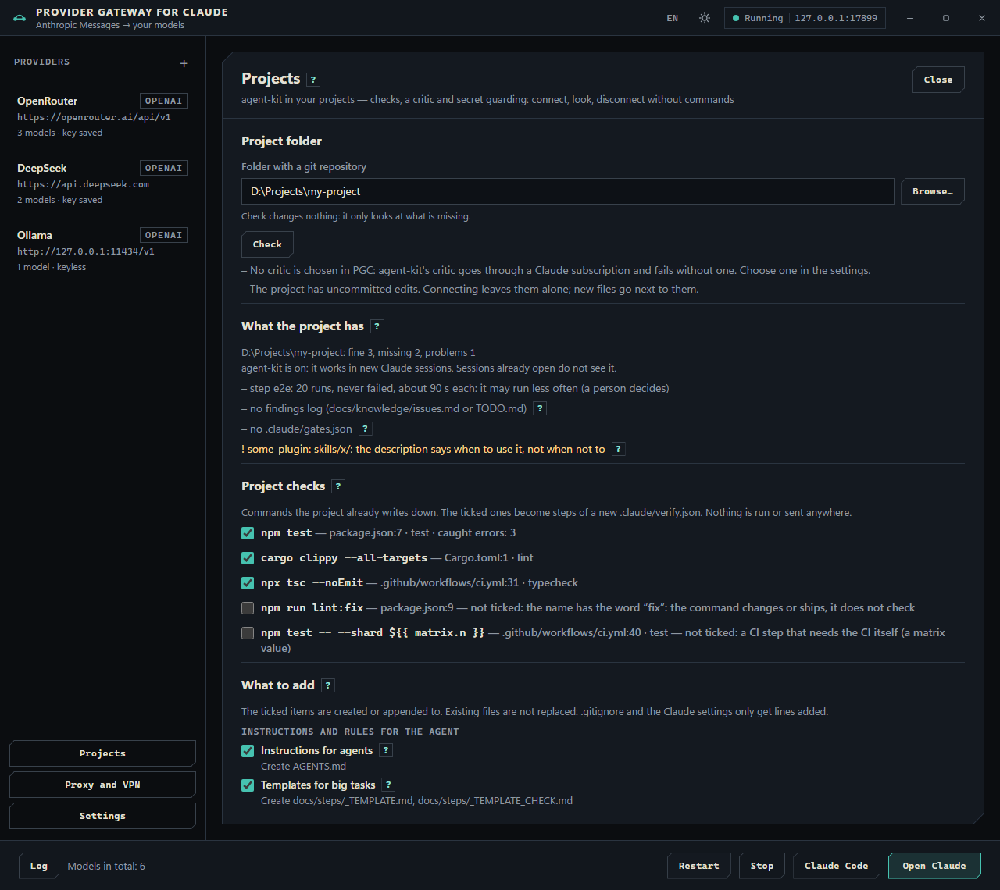

<p align="center">
  
</p>

<h1 align="center">Provider Gateway for Claude</h1>

<p align="center">
  Run Claude Desktop and Claude Code on the models you choose:<br>
  OpenAI, OpenRouter, DeepSeek, Gemini, OpenCode, Ollama, LM Studio or any OpenAI- or Anthropic-compatible API.
</p>

<p align="center">
  <a href="https://github.com/d-ridelman/provider-gateway-for-claude/releases/latest"></a>
  
  
  <a href="#license"></a>
</p>

<p align="center">
  <b>English</b> · <a href="README.ru.md">Русский</a>
</p>

<p align="center">
  
</p>

> **Unofficial.** This project is not affiliated with, endorsed by or sponsored by Anthropic. "Claude" is a trademark of Anthropic, PBC; it is used here only to say which apps the gateway works with.

## What it does

Claude Desktop can run in third-party inference mode and Claude Code can talk to any Anthropic-style endpoint. Provider Gateway for Claude is a small Windows app that runs that endpoint for you on `127.0.0.1` and translates each request to your provider:

- **Anthropic Messages → OpenAI Chat Completions**, including streaming, tool calls, images (also the screenshots that tools return) and reasoning levels; or straight passthrough for Anthropic-compatible providers.
- **Claude Desktop in a separate profile**, so your own Claude account and chats stay untouched. Your models appear in Claude's model menu under readable names. If that Claude is already open, **Open Claude** only shows it (and says when the gateway settings changed); the app never closes or restarts it.
- **Claude Code in one click**: a console opens in your project folder with `claude` already connected to the gateway and your model shown by its real name.

## Features

- Any number of providers, each with its own key, models and reasoning-level ceiling. Templates for OpenAI, OpenRouter, OpenCode Go and Zen, DeepSeek, Gemini, Anthropic, Ollama, llama.cpp and LM Studio.
- **Load models from the provider**, with hints from the open [OpenCode model catalog](https://models.dev): readable names, 1M-context models and supported reasoning levels are filled in for you.
- **Test connection** sends one real request through the gateway and shows the answer.
- **MCP tools on demand.** Claude Code finds MCP tools with its own tool search, as the regular Claude does, instead of sending hundreds of tool schemas on every turn: with a few connectors a turn takes tens of thousands of tokens instead of 150–200 thousand. Works in the console and in the Code tab of Claude Desktop.
- **Free web search for Claude.** Claude's built-in `WebSearch` (Claude Code and Claude Desktop) works without any key or setup: the gateway answers it itself, see [Web search](#web-search).
- **VPN subscriptions on the mihomo core.** Pick a node or Auto, test latency and choose what goes through the VPN: Claude and providers only, the system proxy (works on domain PCs) or all traffic (TUN). See [Proxy and VPN](#proxy-and-vpn).
- **Claude without installing.** Claude Desktop and Claude Code download from Anthropic's own addresses, either portable with nothing installed or as a regular install. The signature and checksum are verified, and the signature must come from Anthropic's own code-signing authority. See [Claude without installing](#claude-without-installing).
- **Keys stay in Windows Credential Manager**, never in files. The gateway listens on `127.0.0.1` only and requires a local token on the message and model routes; `/health` and the `/v1/oauth` setup stubs answer without it. The config files are written through a temporary file, so a cut write cannot empty them.
- **Adapts to picky models.** Providers differ in what they accept, and many answer with a bare 400. The gateway prevents the known trouble (repeated tool names, a conversation that no longer fits the window is reported to Claude Code the way Anthropic does, so it compacts by itself), and when a model refuses a request without saying why, it simplifies it step by step: images left out, reasoning effort, sampling parameters and stream options dropped, tool names shortened, consecutive messages merged, tool schemas simplified, tools capped at 128. The reasoning of earlier replies goes back to providers that require it (DeepSeek's thinking mode with tools) and is dropped for those that refuse it. The one step that made the difference, confirmed twice for a model, is remembered in `model-profiles.json` next to the settings (delete it to forget; entries expire after 30 days) and the gateway log says what it did and what the provider answered.
- **Keeps working after Claude updates**: the app reads Claude's model rules from the installed version, checks its config fields and tells you in Settings if something no longer matches.
- **Russian interface for Claude Desktop** (optional): a separate patched copy of Claude with claude.ai's own Russian translation. The copy also brings back **No folder** in the Code folder picker, which third-party mode hides. When Claude updates, the app prepares the new copy in the background, so **Open Claude** does not wait. Your installed Claude is not modified. The copy is built without Russian too (no translation): only in it do the processes Claude starts (Code sessions, their npm, uv, git, MCP servers) see the real `AppData\Local` instead of the app's folder. When Claude comes as an MSIX package with no Squirrel folder, the copy is built from the installed package. The copy itself does not update Claude; new versions come from the regular Claude.
- **Cowork in Claude Desktop on 3P.** In third-party mode Claude runs Cowork on the host, but its own check turns Cowork off for any copy not started from MSIX. The app patches its copy so Cowork works there without an MSIX package, administrator rights or a VM, and Claude opens on Chat rather than the Code tab. Cowork's own shell lives in the VM, so on the host the session gets Claude Code's PowerShell and Bash, not isolated: every call asks for approval. A Settings choice offers three modes: on the host (portable), off (Chat only), and through an installed Claude MSIX package with the VM (no Russian translation in that mode).
- **Artifacts (Design and Slides, beta)**: a tick in Settings enables them in the third-party profile; live artifacts work without it.
- **A conversation compaction window**: a Settings field takes `400k`, `400000` or `40%` of the model's window for models marked `[1m]`, for Desktop and the console.
- **Projects: connect agent-kit and disconnect it** without typing commands: checks after the agent's edits, a second model that reviews its work, and secret guarding. The project's own checks are listed with ticks, nothing leaves the computer, and Disconnect removes only what agent-kit added and you did not change. See [Projects](#projects).
- **A critic model for project scripts**: pick another gateway model that reviews an agent's work, so a reviewer works without a Claude subscription too.
- **"?" next to the harder settings** opens a short explanation in plain words: what it is, why it is there and what happens if you leave it alone.
- **Lives in the tray** while you work; the gateway keeps running when the window is closed.
- **Updates itself** from GitHub Releases; every update is verified against a signing key built into the app.
- **Built-in browser switch**: third-party mode turns Claude Desktop's browser pane off; a tick in Settings turns it on at every launch from the gateway.
- English and Russian interface, light and dark theme: as in Windows by default, and switchable in the title bar or in Settings.

## Requirements

- Windows 10 version 2004 (build 19041) or Windows 11, x64, with WebView2 (built into Windows 11).
- [Claude Desktop](https://claude.ai/download) for the desktop chat. Tested with Claude Desktop 6.28899.6; on a newer release the app checks it at launch and says in Settings if one of its patches no longer matches.
- [Claude Code](https://docs.claude.com/en/docs/claude-code) for the terminal agent (optional). Tested with Claude Code 2.1.331.
- An account and API key with at least one provider, or a local model server.
- Internet access for the downloads: Claude from Anthropic's own addresses, app updates from GitHub Releases, the Cowork VM image (more than 1 GB) from `downloads.claude.ai`.
- **Cowork with the VM** (the third Cowork mode) also needs Claude installed from Anthropic's `.msix` package (administrator rights), working hardware virtualization and the Virtual Machine Platform optional feature, and the **Log on as a service** right for `NT VIRTUAL MACHINE\Virtual Machines`, which a domain policy can take away. Cowork on the host needs none of this.
- For **Projects** only: [Node.js](https://nodejs.org) 22 or newer, git and Claude Code.

## Install

1. Download `Provider-Gateway-for-Claude_<version>_x64-setup.exe` from [Releases](https://github.com/d-ridelman/provider-gateway-for-claude/releases).
2. Run it. It installs for the current user only and needs no administrator rights.

The installer is not code-signed yet, so Windows SmartScreen may warn about an unknown publisher: choose **More info → Run anyway**. You can compare the file with `SHA256SUMS.txt` from the same release:

```powershell
Get-FileHash .\Provider-Gateway-for-Claude_*_x64-setup.exe -Algorithm SHA256
```

A portable `.exe` is attached to each release as well. Its built-in update runs the installer, so after updating you get the installed app; the portable file itself stays as it was.

## Quick start

1. Click **+**, pick a template (for example *OpenRouter*), paste your API key.
2. Click **Load from provider** and pick models, or type model IDs one per line. Add `[1m]` to a model that has a 1M-token context window.
3. Click **Save**. The gateway starts on its own.
4. Click **Open Claude** for Claude Desktop, or **Claude Code** for a console with the CLI.

<p align="center">
  
  
</p>

### Reasoning levels

Set **Max reasoning level** on a provider and Claude offers a level picker for its models. The gateway passes the chosen level as `reasoning_effort` (OpenAI-compatible) or `output_config.effort` (Anthropic), capped at the maximum. **Default level** is used when Claude sends none, for example Claude Code without `--effort`.

### Main model for Claude Code

Settings → **Model for Claude Code** picks the gateway model for Claude Code. In the **Claude Code** console every role Claude Code asks for goes to it: the session, subagents that inherit the model (Explore, Plan), `model: opus`, `model: haiku` and `model: fable`, and every row of `/model` shows it by name instead of Anthropic's own Opus or Fable. In the Code tab of Claude Desktop (from the next **Open Claude**) it is the main (`sonnet`) model; the other roles there are Desktop's own choice. A subagent can also name any gateway model directly in its `model:` field, and `/model <name>` switches the session.

### Critic for project scripts

Settings → **Critic for project scripts** picks a second gateway model that reviews an agent's work (agent-kit's critic answers ACCEPT or REJECT with a reason). Another model than the main one is better: the same model has the same blind spots. When a critic is chosen and the gateway runs, Claude Desktop and the console opened from PGC get `AGENT_KIT_PGC_URL`, `AGENT_KIT_PGC_TOKEN` (the gateway's local token), `AGENT_KIT_PGC_MODEL` and `AGENT_KIT_CRITIC_VIA=pgc`, so project scripts started there can call it. The token works only on `127.0.0.1`; still, every script started from those sessions can read it. Changing the critic does not restart the gateway.

### Projects

<p align="center">
  
</p>

**Projects** (bottom left, marked beta: the page is new and its texts and steps may still change) sets up [agent-kit](#agent-kit), a Claude Code plugin, in a project folder without commands, and takes it out again:

1. **Check** changes nothing. It says what is missing: Node.js 22+, git, Claude Code, a git repository, where to get agent-kit, no critic chosen, uncommitted edits.
2. **Connect** turns the plugin on only for you (`.claude/settings.local.json`, outside git), unless you tick **For the whole team**. A plugin you turned off is turned back on only in this project.
3. The page then shows what the project has, the **project checks** and a **plan with ticks**:
   - checks are the commands the project already writes down (package.json scripts, Cargo, Makefile, pyproject, Go, its CI), each with the file and line it comes from. Commands whose name says they change or ship something (`fix`, `deploy`, `publish`…) are unticked, with the reason. The ticked ones become the steps of a new `.claude/verify.json`; a project's own `verify.json` is not changed, and the steps are shown to add by hand. Nothing is run;
   - the plan groups what agent-kit offers to add (instructions for the agent, checks and the critic, protection, project documents) under plain names; "?" says what each one is for;
   - a draft of critic rules made from the project's own README, AGENTS.md and ADRs is offered unticked, with each rule and the file and line it came from.
4. **Apply the ticked** applies only what is ticked. Existing files are not replaced; `.gitignore` and the Claude settings get lines added. New Claude sessions see the plugin. **Back** returns to the folder.
5. For a connected folder, **Disconnect…** shows what to remove, with ticks: files agent-kit added and you did not change, and the lines it added to `.gitignore` and the Claude settings. A file you edited is listed but left alone. The plugin is taken out of this project last (only for you; "for the whole team" is a separate, unticked item). agent-kit knows its own files from a journal it keeps next to git (`.git/agent-kit/applied.jsonl`); what was in git comes back from git.

No model is asked and no project file is sent anywhere: on 15 open projects a pick by code found as many of their CI checks as a model did.

#### agent-kit

The installer and the portable exe carry a pinned agent-kit (MIT). When Claude Code has no agent-kit marketplace, PGC unpacks it to its own folder and installs it from there. When the agent-kit in PGC, or in a marketplace folder you added yourself, differs from the project's copy, the page offers **Update agent-kit**; nothing updates by itself.

### Web search

Claude's `WebSearch` normally runs on Anthropic's servers, so through a third-party provider the model got nothing. The gateway now answers it itself, in the form Anthropic's server uses: it searches DuckDuckGo and Brave with no key (answers are cached for 10 minutes; the tool's `allowed_domains` and `blocked_domains` are honored). When a search engine asks for a human check, the app opens that page in its own WebView2 window as a real visit, and the window shows itself if it needs a tick. There is nothing to set up and no switch yet: the search words go to those search engines (see [Privacy and network](#privacy-and-network)). Checked in the Claude Code console and in the Code tab of Claude Desktop.

### Proxy and VPN

**Proxy and VPN** sits at the bottom left. The app runs the [mihomo](https://github.com/MetaCubeX/mihomo) core (Clash.Meta) with your VPN subscriptions. Paste a subscription address: Clash/mihomo links and base64 subscriptions with vless, vmess, ss, trojan and hysteria2 nodes all work. Its nodes appear as tiles with their latency. Click a node to use it, or pick **Auto** for the fastest. **Test latency** measures every node, and a subscription's row shows its traffic and expiry. The core updates subscriptions on its own every 6, 12 or 24 hours, and Update does it now. The title bar shows a "VPN · node · ms" chip; it turns red if the core stops or a policy resets the proxy.

What goes through the VPN:

| Mode | Through the VPN | Rights |
|---|---|---|
| Claude and providers only | the gateway (provider requests, web search, model catalog), Claude from PGC (`--proxy-server`) and the Claude Code console (`HTTPS_PROXY`) | none |
| System proxy | plus browsers and programs that use the Windows proxy (your regular Claude too) | none, so it suits domain PCs |
| All traffic (TUN) | every program | administrator: Windows asks each time the core starts |

Local addresses, private networks and `.local`, `.lan`, `.internal`, `.home.arpa` names (Ollama, LM Studio, the intranet) go direct in every mode. A LAN server named without a dot or by a corporate domain goes through the VPN, so give such a server by its IP. If the core is not running, the gateway's requests fail with an error instead of slipping past the VPN.

The core is not part of the app. **Download the core** gets a pinned version from its author's GitHub (v1.19.34 now, about 22 MB) and checks its sha256, which is built into PGC: a newer core arrives with a PGC update, signed with PGC's key. The core runs as a separate process and closes with PGC. Some antivirus programs flag mihomo as a "potentially unwanted program"; if the file is quarantined, the window says so and offers to download it again.

**System proxy** is set through WinINet, the way the Windows Proxy settings page does it. Your previous settings (manual proxy, PAC script, auto-detection, bypass list) are saved before the switch and come back when you turn the mode off or quit PGC. If PGC crashed, that happens at its next start; until then programs point at a dead port. If a group policy forbids changing the proxy, the window says so, and Claude and providers only still works. If a domain PC reaches the internet only through a corporate proxy, the core cannot yet reach the nodes through it.

**TUN** starts the core with administrator rights through UAC; PGC itself stays a normal process. An elevated helper stops the core when PGC closes. Before every start, the sha256 of `mihomo.exe` itself is checked, and the file stays locked against writes until the core starts, so it cannot be swapped in the user's folder. If the UAC prompt is refused, the previous mode stays. If the core crashes, the system proxy is put back on its own and the chip turns red.

A subscription address is a secret: it is kept in Credential Manager, and the window and the log show only its server. The core gets it in its own config file (`mihomo\home\config.yaml`) and keeps the downloaded node list in `mihomo\home\providers`.

### Claude without installing

Settings → **Download Claude Desktop** and **Download Claude Code**: both come from Anthropic's own addresses, in one of two ways.

- **Without installing** (for PCs where you may not install software). Claude Desktop is unpacked from its full package into the app folder, and Open Claude runs it. Claude Code goes into the same folder, and the "Portable Claude Code" tick makes the **Claude Code** button use it. Portable Claude Code has its own settings folder (`CLAUDE_CONFIG_DIR`) and its self-update is off; PGC updates it with the same button.
- **Install**: the official Claude Desktop installer, or `claude install` for Claude Code, the way Anthropic does it. If Claude is already installed, the window asks first, because that is your regular Claude.

With the VPN on in PGC, downloads go through it. If the core is not running, the download does not start and the window says why; if the node does not answer, the error suggests picking another. The mihomo core itself is downloaded directly.

Checks: sha256 from the release manifest for Claude Code, sha1 from `RELEASES` for Claude Desktop (the same check Squirrel makes). Every `claude.exe` must carry an Authenticode signature by "Anthropic, PBC". A portable Claude writes `claude://` into the registry when it starts; once it closes, PGC gives those keys back to the installed Claude, or removes them if there is none.

## Privacy and network

The app talks to:

| Where | When |
|---|---|
| The providers you add | When Claude or Claude Code sends a request, and on **Load from provider** / **Test connection** |
| `models.opencode.ai` | On **Load from provider**, for model names and limits; nothing about you is sent |
| `claude.ai/i18n/ru.json`, `claude.ai/i18n/dynamic/ru.json` | Only with the Russian Claude interface turned on, when Claude updates |
| An agent-kit source you type yourself on **Projects** | Only if Claude Code has no agent-kit marketplace and you set one; the built-in agent-kit needs no network |
| `github.com` (this repository's releases) | Update check at start and once a day; turn it off in Settings |
| `html.duckduckgo.com`, `lite.duckduckgo.com`, `search.brave.com` | When Claude's built-in web search runs: the gateway answers it itself and sends the words the model chose to search for (no account, no keys). It is always on (there is no switch for it yet) |
| `github.com/MetaCubeX/mihomo` (releases) | Only on **Download the core** |
| Your VPN subscription addresses and their nodes | While the proxy is on: the core updates subscriptions and goes through the chosen node |
| `www.gstatic.com/generate_204` | Node latency tests (the core) |
| `1.1.1.1`, `dns.google` | The core's DNS, in TUN mode only |
| `downloads.claude.ai`, `claude.ai` | Only on **Download Claude Desktop / Claude Code** |

There is no telemetry. Prompts and answers go only between Claude and your provider through the local gateway; the search words of a web search also go to the search engines above. Those search words are written to `gateway.log` next to the settings, in plain text.

## Where things are

| What | Path |
|---|---|
| Settings and log | `%APPDATA%\app.provider-gateway-for-claude` |
| Provider keys | Windows Credential Manager, service `claude-provider-gateway` |
| Claude Desktop profile used by the app | `%LOCALAPPDATA%\ClaudeProviderGateway\Claude-3p` |
| Claude copy (~700 MB, with or without the translation) | `%LOCALAPPDATA%\ClaudeProviderGateway\claude-ru` |
| Russian translation of claude.ai | `%APPDATA%\app.provider-gateway-for-claude\claude-ru.json` |
| What the gateway learned about picky models | `%APPDATA%\app.provider-gateway-for-claude\model-profiles.json` |
| The mihomo core, its config and log | `%LOCALAPPDATA%\ClaudeProviderGateway\mihomo` |
| VPN subscription addresses | Windows Credential Manager, the same service, names `subscription:<id>` |
| Portable Claude Desktop | `%LOCALAPPDATA%\ClaudeProviderGateway\claude-desktop\app-<version>` |
| Portable Claude Code and its settings | `%LOCALAPPDATA%\ClaudeProviderGateway\claude-code` (`config` is its `CLAUDE_CONFIG_DIR`) |
| The built-in agent-kit, unpacked | `%LOCALAPPDATA%\ClaudeProviderGateway\agent-kit` |
| Effort-menu translation for the installed Claude | `%APPDATA%\app.provider-gateway-for-claude\claude-ru-dynamic.json` |
| Your own Claude Code model, kept while a PGC console runs | `%LOCALAPPDATA%\ClaudeProviderGateway\code-model-before.json` |

claude.ai sometimes answers programs with a bot check. The app then loads the translation in its built-in browser (WebView2), which passes the check like any visitor; if it does not pass on its own within a few seconds (claude.ai wants a box ticked), that window appears so you can finish it. If it still fails, open `https://claude.ai/i18n/ru.json` in your browser and save it as that `claude-ru.json`: the compatibility check in Settings shows the exact path.

## Build from source

Requirements: Rust 1.90+ with the MSVC toolchain, Node.js (for the translation check in `tools\ci.ps1` and for the installer), Python 3 (optional, refreshes license notices).

```powershell
.\tools\ci.ps1               # translations, fmt, clippy and tests, as GitHub CI runs them
.\build-app.ps1              # portable exe in dist\
.\build-app.ps1 -Installer   # plus the NSIS installer
```

`git config core.hooksPath .githooks` runs the same checks before every push.

The workspace has three crates:

- `crates/ctp-core` — configuration and model naming shared by the others;
- `crates/ctp-gateway` — the Anthropic Messages gateway, also usable on its own (`ctp-gateway --providers-file providers.json`, with the client token in `GATEWAY_TOKEN`);
- `crates/ctp-app` — the Windows app (Tauri 2).

A build carries agent-kit only after `.\tools\kit-snapshot.ps1` has taken the commit pinned in `crates\ctp-app\kit.pin` from an agent-kit clone in `..\agent-kit`; without it the app works and **Connect a project** installs agent-kit from a marketplace or a source you set. agent-kit has no repository of its own: it ships only inside PGC, and its source (MIT) is the copy inside the installer, unpacked to `%LOCALAPPDATA%\ClaudeProviderGateway\agent-kit`. Without the project's updater key (`TAURI_SIGNING_PRIVATE_KEY`), `-Installer` builds a plain installer with no update signatures. Releases are prepared with `tools/release.ps1` (signed installer, `latest.json`, checksums). `tools/cloudflare-mirror` is an optional update mirror for networks where GitHub is slow or unreachable.

## Contributing

Bug reports, provider templates and translations are welcome: see [CONTRIBUTING.md](CONTRIBUTING.md) and the [changelog](CHANGELOG.md). Security issues go through private reporting, as described in [SECURITY.md](SECURITY.md).

## License

Licensed under either of [Apache License 2.0](LICENSE-APACHE) or [MIT license](LICENSE-MIT) at your option. Third-party components and their licenses are listed in [THIRD-PARTY-NOTICES.txt](THIRD-PARTY-NOTICES.txt).
