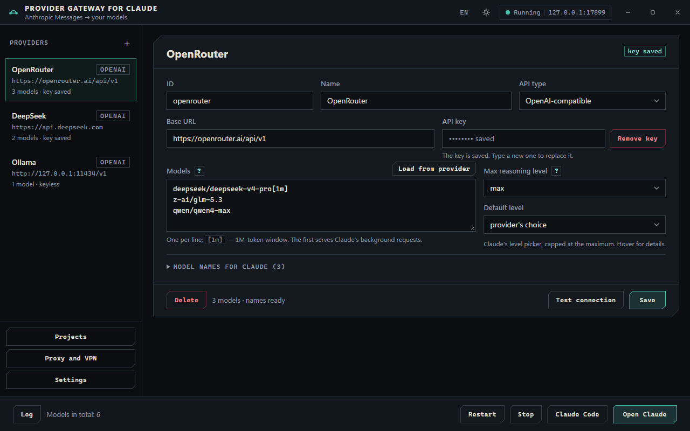
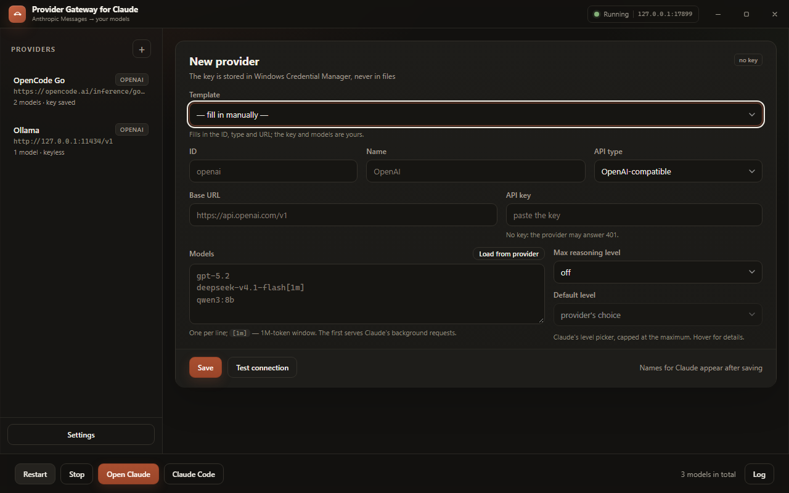
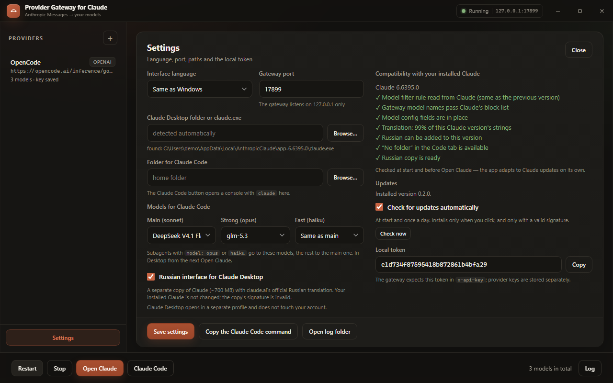

<p align="center">
  
</p>

<h1 align="center">Provider Gateway for Claude</h1>

<p align="center">
  Run Claude Desktop and Claude Code on the models you choose:<br>
  OpenAI, OpenRouter, DeepSeek, Gemini, OpenCode, Ollama, LM Studio or any OpenAI- or Anthropic-compatible API.
</p>

<p align="center">
  <a href="https://github.com/d-ridelman/provider-gateway-for-claude/releases/latest"></a>
  
  
  <a href="#license"></a>
</p>

<p align="center">
  <b>English</b> · <a href="README.ru.md">Русский</a>
</p>

<p align="center">
  
</p>

> **Unofficial.** This project is not affiliated with, endorsed by or sponsored by Anthropic. "Claude" is a trademark of Anthropic, PBC; it is used here only to say which apps the gateway works with.

## What it does

Claude Desktop can run in third-party inference mode and Claude Code can talk to any Anthropic-style endpoint. Provider Gateway for Claude is a small Windows app that runs that endpoint for you on `127.0.0.1` and translates each request to your provider:

- **Anthropic Messages → OpenAI Chat Completions**, including streaming, tool calls, images (also the screenshots that tools return) and reasoning levels; or straight passthrough for Anthropic-compatible providers.
- **Claude Desktop in a separate profile**, so your own Claude account and chats stay untouched. Your models appear in Claude's model menu under readable names. If that Claude is already open, **Open Claude** only shows it (and says when the gateway settings changed); the app never closes or restarts it.
- **Claude Code in one click**: a console opens in your project folder with `claude` already connected to the gateway.

## Features

- Any number of providers, each with its own key, models and reasoning-level ceiling. Templates for OpenAI, OpenRouter, OpenCode Go and Zen, DeepSeek, Gemini, Anthropic, Ollama, llama.cpp and LM Studio.
- **Load models from the provider**, with hints from the open [OpenCode model catalog](https://models.dev): readable names, 1M-context models and supported reasoning levels are filled in for you.
- **Test connection** sends one real request through the gateway and shows the answer.
- **Free web search for Claude.** Claude's built-in `WebSearch` (Claude Code and Claude Desktop) works without any key or setup: the gateway answers it itself, see [Web search](#web-search).
- **Keys stay in Windows Credential Manager**, never in files. The gateway listens on `127.0.0.1` only and requires a local token. The config files are written through a temporary file, so a cut write cannot empty them.
- **Adapts to picky models.** Providers differ in what they accept, and many answer with a bare 400. The gateway prevents the known trouble (repeated tool names, a conversation that no longer fits the window is reported to Claude Code the way Anthropic does, so it compacts by itself), and when a model refuses a request without saying why, it simplifies it step by step: images left out, reasoning effort, sampling parameters and stream options dropped, tool names shortened, consecutive messages merged, tool schemas simplified, tools capped at 128. The reasoning of earlier replies goes back to providers that require it (DeepSeek's thinking mode with tools) and is dropped for those that refuse it. The one step that made the difference, confirmed twice for a model, is remembered in `model-profiles.json` next to the settings (delete it to forget; entries expire after 30 days) and the gateway log says what it did and what the provider answered.
- **Keeps working after Claude updates**: the app reads Claude's model rules from the installed version, checks its config fields and tells you in Settings if something no longer matches.
- **Russian interface for Claude Desktop** (optional): a separate patched copy of Claude with claude.ai's own Russian translation. The copy also brings back **No folder** in the Code folder picker, which third-party mode hides. When Claude updates, the app prepares the new copy in the background, so **Open Claude** does not wait. Your installed Claude is not modified.
- **Lives in the tray** while you work; the gateway keeps running when the window is closed.
- **Updates itself** from GitHub Releases; every update is verified against a signing key built into the app.
- **Built-in browser switch**: third-party mode turns Claude Desktop's browser pane off; a tick in Settings turns it on at every launch from the gateway.
- English and Russian interface, light and dark theme: as in Windows by default, and switchable in the title bar or in Settings.

## Requirements

- Windows 10 or 11, x64, with WebView2 (built into Windows 11).
- [Claude Desktop](https://claude.ai/download) for the desktop chat. Tested with Claude Desktop 6.28899.6.
- [Claude Code](https://docs.claude.com/en/docs/claude-code) for the terminal agent (optional).
- An account and API key with at least one provider, or a local model server.

## Install

1. Download `Provider-Gateway-for-Claude_<version>_x64-setup.exe` from [Releases](https://github.com/d-ridelman/provider-gateway-for-claude/releases).
2. Run it. It installs for the current user only and needs no administrator rights.

The installer is not code-signed yet, so Windows SmartScreen may warn about an unknown publisher: choose **More info → Run anyway**. You can compare the file with `SHA256SUMS.txt` from the same release:

```powershell
Get-FileHash .\Provider-Gateway-for-Claude_*_x64-setup.exe -Algorithm SHA256
```

A portable `.exe` is attached to each release as well. Its built-in update runs the installer, so after updating you get the installed app; the portable file itself stays as it was.

## Quick start

1. Click **+**, pick a template (for example *OpenRouter*), paste your API key.
2. Click **Load from provider** and pick models, or type model IDs one per line. Add `[1m]` to a model that has a 1M-token context window.
3. Click **Save**. The gateway starts on its own.
4. Click **Open Claude** for Claude Desktop, or **Claude Code** for a console with the CLI.

<p align="center">
  
  
</p>

### Reasoning levels

Set **Max reasoning level** on a provider and Claude offers a level picker for its models. The gateway passes the chosen level as `reasoning_effort` (OpenAI-compatible) or `output_config.effort` (Anthropic), capped at the maximum. **Default level** is used when Claude sends none, for example Claude Code without `--effort`.

### Different models for subagents

Claude Code asks for models by role: `sonnet`, `opus` and `haiku`. Settings → **Models for Claude Code** picks a gateway model for each: main (`sonnet`: the console session, subagents that inherit the model such as Explore and Plan, and every role left unassigned), strong (`opus`, for subagents with `model: opus`) and fast (`haiku`, for subagents with `model: haiku` and background tasks). It applies to the **Claude Code** console, the copied command and the Code tab of Claude Desktop (from the next **Open Claude**). A subagent can also name any gateway model directly in its `model:` field, and `/model <name>` switches the session. Subagents with `model: fable` get the strong model as well: in the console always, in the Russian copy of Claude Desktop when the strong model is on an OpenAI-compatible provider.

### Advisor

Claude Code's advisor (`/advisor`) lets the working model consult a stronger one in the middle of a task. At Anthropic it is a server-side tool, so through a third-party provider it would simply be off. With a strong model chosen, the gateway runs it itself: the main model calls `advisor`, the gateway asks the strong model with the whole conversation and puts its advice into the same reply, as Anthropic's server does.

Settings → **Strong is the advisor (`/advisor`)** under the model roles turns it on: the app writes `advisorModel` to Claude Code's settings (`~/.claude/settings.json`), the same thing `/advisor` does. That file is shared by every Claude Code on the computer, so in the regular Claude Code with an Anthropic account the advisor is on as well (an Anthropic model there); unticking is `/advisor off`. Until you decide, the box is ticked, and the first save writes it (once: after that the app never turns the advisor on by itself, so a later `/advisor off` stays off); a model you already chose with `/advisor` is kept. If the settings file cannot be read, the app leaves it alone. Whichever Claude model is named, the gateway answers with the strong one. It works with OpenAI-compatible providers, in the **Claude Code** console and in the Code tab of the Russian copy of Claude Desktop. Not covered: the Code tab of the regular Claude Desktop (it turns experimental features off for its sessions) and Anthropic-type providers. The gateway log shows each consultation (`advisor consulted`, model and time).

### Web search

Claude's `WebSearch` normally runs on Anthropic's servers, so through a third-party provider the model got nothing. The gateway now answers it itself, in the form Anthropic's server uses: it searches DuckDuckGo and Brave with no key (answers are cached for 10 minutes; the tool's `allowed_domains` and `blocked_domains` are honored). When a search engine asks for a human check, the app opens that page in its own WebView2 window as a real visit, and the window shows itself if it needs a tick. There is nothing to set up and no switch yet: the search words go to those search engines (see [Privacy and network](#privacy-and-network)). Checked in the Claude Code console and in the Code tab of Claude Desktop.

### Claude Code by hand

Settings → **Copy the Claude Code command** puts a PowerShell snippet on the clipboard with the same variables the **Claude Code** button sets (gateway address, token, model roles), if you prefer your own terminal.

## Privacy and network

The app talks to:

| Where | When |
|---|---|
| The providers you add | When Claude or Claude Code sends a request, and on Load models / Test connection |
| `models.opencode.ai` | On **Load from provider**, for model names and limits; nothing about you is sent |
| `claude.ai/i18n/ru.json` | Only with the Russian Claude interface turned on, when Claude updates |
| `github.com` (this repository's releases) | Update check at start and once a day; turn it off in Settings |
| `html.duckduckgo.com`, `lite.duckduckgo.com`, `search.brave.com` | When Claude's built-in web search runs: the gateway answers it itself and sends the words the model chose to search for (no account, no keys). It is always on (there is no switch for it yet) |

There is no telemetry. Prompts and answers go only between Claude and your provider through the local gateway; the search words of a web search also go to the search engines above. Those search words are written to `gateway.log` next to the settings, in plain text.

## Where things are

| What | Path |
|---|---|
| Settings and log | `%APPDATA%\app.provider-gateway-for-claude` |
| Provider keys | Windows Credential Manager, service `claude-provider-gateway` |
| Claude Desktop profile used by the app | `%LOCALAPPDATA%\ClaudeProviderGateway\Claude-3p` |
| Russian Claude copy (~700 MB, optional) | `%LOCALAPPDATA%\ClaudeProviderGateway\claude-ru` |
| Russian translation of claude.ai | `%APPDATA%\app.provider-gateway-for-claude\claude-ru.json` |
| What the gateway learned about picky models | `%APPDATA%\app.provider-gateway-for-claude\model-profiles.json` |

claude.ai sometimes answers programs with a bot check. The app then loads the translation in its built-in browser (WebView2), which passes the check like any visitor; if it does not pass on its own within a few seconds (claude.ai wants a box ticked), that window appears so you can finish it. If it still fails, open `https://claude.ai/i18n/ru.json` in your browser and save it as that `claude-ru.json`: the compatibility check in Settings shows the exact path.

## Build from source

Requirements: Rust 1.90+ with the MSVC toolchain, Node.js (for the installer), Python 3 (optional, refreshes license notices).

```powershell
cargo test --workspace
.\build-app.ps1              # portable exe in dist\
.\build-app.ps1 -Installer   # plus the NSIS installer
```

The workspace has three crates:

- `crates/ctp-core` — configuration and model naming shared by the others;
- `crates/ctp-gateway` — the Anthropic Messages gateway, also usable on its own (`ctp-gateway --providers-file providers.json`, with the client token in `GATEWAY_TOKEN`);
- `crates/ctp-app` — the Windows app (Tauri 2).

Without the project's updater key (`TAURI_SIGNING_PRIVATE_KEY`), `-Installer` builds a plain installer with no update signatures. Releases are prepared with `tools/release.ps1` (signed installer, `latest.json`, checksums). `tools/cloudflare-mirror` is an optional update mirror for networks where GitHub is slow or unreachable.

## Contributing

Bug reports, provider templates and translations are welcome: see [CONTRIBUTING.md](CONTRIBUTING.md) and the [changelog](CHANGELOG.md). Security issues go through private reporting, as described in [SECURITY.md](SECURITY.md).

## License

Licensed under either of [Apache License 2.0](LICENSE-APACHE) or [MIT license](LICENSE-MIT) at your option. Third-party components and their licenses are listed in [THIRD-PARTY-NOTICES.txt](THIRD-PARTY-NOTICES.txt).
