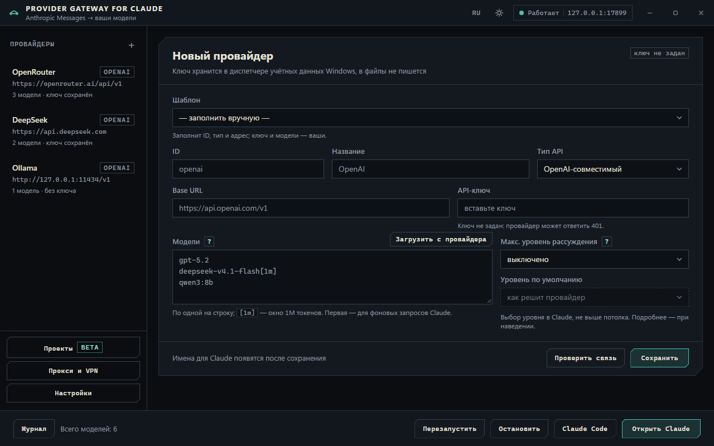

<p align="center">
  
</p>

<h1 align="center">Provider Gateway for Claude</h1>

<p align="center">
  Claude Desktop и Claude Code на тех моделях, которые выбрали вы:<br>
  OpenAI, OpenRouter, DeepSeek, Gemini, OpenCode, Ollama, LM Studio или любой OpenAI- либо Anthropic-совместимый API.
</p>

<p align="center">
  <a href="https://github.com/d-ridelman/provider-gateway-for-claude/releases/latest"></a>
  
  
  <a href="#лицензия"></a>
</p>

<p align="center">
  <a href="README.md">English</a> · <b>Русский</b>
</p>

<p align="center">
  
</p>

> **Неофициальный проект.** Не связан с Anthropic, не одобрен и не спонсируется ею. «Claude» — товарный знак Anthropic, PBC; здесь он только называет приложения, с которыми работает шлюз.

## Что это

Claude Desktop умеет работать в режиме стороннего провайдера, а Claude Code — с любым адресом в формате Anthropic API. Provider Gateway for Claude — небольшое приложение для Windows: оно поднимает такой адрес на `127.0.0.1` и переводит каждый запрос вашему провайдеру.

- **Anthropic Messages → OpenAI Chat Completions** со стримингом, вызовами инструментов, картинками и уровнями рассуждения; для Anthropic-совместимых провайдеров — прямая передача.
- **Claude Desktop в отдельном профиле**: ваш аккаунт Claude и чаты не трогаются. Модели появляются в меню выбора модели под понятными именами.
- **Claude Code в один клик**: консоль открывается в папке проекта, и `claude` уже подключён к шлюзу.

## Возможности

- Сколько угодно провайдеров, у каждого свои ключ, модели и потолок уровня рассуждения. Шаблоны для OpenAI, OpenRouter, OpenCode Go и Zen, DeepSeek, Gemini, Anthropic, Ollama, llama.cpp и LM Studio.
- **Загрузка списка моделей с провайдера** с подсказками из открытого [каталога моделей OpenCode](https://models.dev): имена, модели с окном 1M и поддерживаемые уровни рассуждения подставляются сами.
- **«Проверить связь»** отправляет через шлюз один настоящий запрос и показывает ответ.
- **Ключи лежат в диспетчере учётных данных Windows**, а не в файлах. Шлюз слушает только `127.0.0.1` и требует локальный токен.
- **Не ломается после обновлений Claude**: приложение читает правила моделей из установленной версии, сверяет поля конфигурации и показывает в настройках, если что-то перестало совпадать.
- **Русский интерфейс Claude Desktop** (по желанию): отдельная копия Claude с официальным русским переводом claude.ai. В этой копии в выборе папки Code есть и **«Без папки»**, который режим стороннего провайдера скрывает. Когда Claude обновляется, приложение готовит новую копию в фоне, и «Открыть Claude» не ждёт. Установленный Claude не меняется.
- **Работает в трее**: окно можно закрыть, шлюз продолжит работать.
- **Обновляется само** из релизов GitHub; каждое обновление сверяется с ключом подписи, встроенным в программу.
- Интерфейс на русском и английском — по языку Windows; светлая и тёмная тема тоже как в Windows.

## Что нужно

- Windows 10 или 11, x64, с WebView2 (в Windows 11 он уже есть).
- [Claude Desktop](https://claude.ai/download) для чата. Проверено на Claude Desktop 6.6395.0.
- [Claude Code](https://docs.claude.com/en/docs/claude-code) для агента в терминале (по желанию).
- Аккаунт и API-ключ хотя бы у одного провайдера или локальный сервер моделей.

## Установка

1. Скачайте `Provider-Gateway-for-Claude_<версия>_x64-setup.exe` со страницы [Releases](https://github.com/d-ridelman/provider-gateway-for-claude/releases).
2. Запустите. Установка только для текущего пользователя, права администратора не нужны.

Установщик пока не подписан сертификатом, поэтому SmartScreen может предупредить о неизвестном издателе: **Подробнее → Выполнить в любом случае**. Файл можно сверить с `SHA256SUMS.txt` из того же релиза:

```powershell
Get-FileHash .\Provider-Gateway-for-Claude_*_x64-setup.exe -Algorithm SHA256
```

К каждому релизу приложен и переносной `.exe`. Его встроенное обновление запускает установщик: после обновления у вас будет установленная версия, а сам переносной файл останется прежним.

## Быстрый старт

1. Нажмите **+**, выберите шаблон (например, *OpenRouter*) и вставьте API-ключ.
2. Нажмите **Загрузить с провайдера** и отметьте модели или впишите их ID по одному на строку. Модели с окном 1M токенов допишите `[1m]`.
3. Нажмите **Сохранить** — шлюз запустится сам.
4. **Открыть Claude** — Claude Desktop, **Claude Code** — консоль с CLI.

<p align="center">
  
  
</p>

### Уровни рассуждения

Задайте у провайдера **Макс. уровень рассуждения** — и Claude покажет выбор уровня для его моделей. Шлюз передаст выбранный уровень как `reasoning_effort` (OpenAI-совместимые) или `output_config.effort` (Anthropic), не выше потолка. **Уровень по умолчанию** используется, если Claude уровень не прислал, например Claude Code без `--effort`.

### Разные модели для субагентов

Claude Code просит модели по ролям: `sonnet`, `opus` и `haiku`. Настройки → **Модели для Claude Code** назначают каждой роли модель шлюза: основную (`sonnet`: сессия в консоли, субагенты, которые наследуют модель, вроде Explore и Plan, и все невыбранные роли), сильную (`opus`, для субагентов с `model: opus`) и быструю (`haiku`, для субагентов с `model: haiku` и фоновых мелочей). Выбор действует в консоли кнопки **Claude Code**, в скопированной команде и во вкладке Code у Claude Desktop (со следующего **«Открыть Claude»**). Ещё субагент может прямо указать любую модель шлюза в поле `model:`, а `/model <имя>` переключает сессию. Субагенты с `model: fable` тоже получают сильную модель: в консоли всегда, в русской копии Claude Desktop — если сильная модель на OpenAI-совместимом провайдере.

### Советник

Советник Claude Code (`/advisor`) позволяет рабочей модели посреди задачи посоветоваться с более сильной. У Anthropic это серверный инструмент, поэтому через стороннего провайдера он просто выключен. Если выбрана сильная модель, шлюз исполняет советника сам: основная модель вызывает `advisor`, шлюз спрашивает сильную модель, показав ей весь разговор, и вставляет её совет в тот же ответ, как это делает сервер Anthropic.

Включает его галочка в Настройках **«Сильная — ещё и советник Claude Code»**: программа пишет `advisorModel` в настройки Claude Code (`~/.claude/settings.json`), то же самое делает `/advisor`. Файл общий для всех Claude Code на компьютере, поэтому в обычном Claude Code с аккаунтом Anthropic советник тоже включится (там это модель Anthropic); снять галочку — то же, что `/advisor off`. Пока вы не решили, галочка стоит; выбор, уже сделанный через `/advisor`, сохраняется. Какую бы модель Claude ни назвать, шлюз ответит сильной. Работает с OpenAI-совместимыми провайдерами — в консоли кнопки **Claude Code** и во вкладке Code русской копии Claude Desktop. Не работает во вкладке Code обычного Claude Desktop (он выключает своим сессиям экспериментальные функции) и с провайдерами типа Anthropic. Каждое обращение видно в журнале шлюза (`advisor consulted`, модель и время).

### Claude Code вручную

Настройки → **Скопировать команду для Claude Code** кладёт в буфер команду PowerShell с теми же переменными, что задаёт кнопка **Claude Code** (адрес шлюза, токен, роли моделей), — если удобнее свой терминал.

## Приватность и сеть

Приложение обращается к:

| Куда | Когда |
|---|---|
| К добавленным вами провайдерам | Когда Claude или Claude Code отправляет запрос, а также по «Загрузить с провайдера» и «Проверить связь» |
| `models.opencode.ai` | По «Загрузить с провайдера» — за именами и лимитами моделей; данных о вас не передаётся |
| `claude.ai/i18n/ru.json` | Только с включённым русским интерфейсом Claude, после обновления Claude |
| `github.com` (релизы этого репозитория) | Проверка обновлений при старте и раз в сутки; выключается в настройках |

Телеметрии нет. Запросы и ответы идут только между Claude и вашим провайдером через локальный шлюз.

## Где что лежит

| Что | Где |
|---|---|
| Настройки и журнал | `%APPDATA%\app.provider-gateway-for-claude` |
| Ключи провайдеров | Диспетчер учётных данных Windows, служба `claude-provider-gateway` |
| Профиль Claude Desktop для приложения | `%LOCALAPPDATA%\ClaudeProviderGateway\Claude-3p` |
| Русская копия Claude (~700 МБ, по желанию) | `%LOCALAPPDATA%\ClaudeProviderGateway\claude-ru` |
| Русский перевод claude.ai | `%APPDATA%\app.provider-gateway-for-claude\claude-ru.json` |

claude.ai иногда отвечает программам проверкой на бота. Тогда приложение загружает перевод во встроенном браузере (WebView2), который проходит проверку, как обычный посетитель; если за несколько секунд она не прошла сама (claude.ai просит поставить галочку), окно появится, чтобы вы её завершили. Если не вышло и так, откройте `https://claude.ai/i18n/ru.json` в браузере и сохраните как этот `claude-ru.json` — точный путь покажет проверка совместимости в настройках.

## Сборка из исходников

Нужно: Rust 1.90+ с MSVC, Node.js (для установщика), Python 3 (по желанию, обновляет список лицензий).

```powershell
cargo test --workspace
.\build-app.ps1              # переносной exe в dist\
.\build-app.ps1 -Installer   # и установщик NSIS
```

В рабочем пространстве три крейта:

- `crates/ctp-core` — конфигурация и имена моделей, общие для остальных;
- `crates/ctp-gateway` — шлюз Anthropic Messages, работает и сам по себе (`ctp-gateway --providers-file providers.json`, токен клиентов — в `GATEWAY_TOKEN`);
- `crates/ctp-app` — приложение для Windows (Tauri 2).

Без ключа обновлений проекта (`TAURI_SIGNING_PRIVATE_KEY`) `-Installer` соберёт обычный установщик без подписей обновлений. Релизы готовит `tools/release.ps1` (подписанный установщик, `latest.json`, контрольные суммы). `tools/cloudflare-mirror` — необязательное зеркало обновлений для сетей, где GitHub медленный или недоступен.

## Участие

Сообщения об ошибках, шаблоны провайдеров и переводы приветствуются: см. [CONTRIBUTING.md](CONTRIBUTING.md) и [список изменений](CHANGELOG.md). Об уязвимостях сообщайте приватно, как описано в [SECURITY.md](SECURITY.md).

## Лицензия

На выбор: [Apache License 2.0](LICENSE-APACHE) или [MIT](LICENSE-MIT). Сторонние компоненты и их лицензии перечислены в [THIRD-PARTY-NOTICES.txt](THIRD-PARTY-NOTICES.txt).
