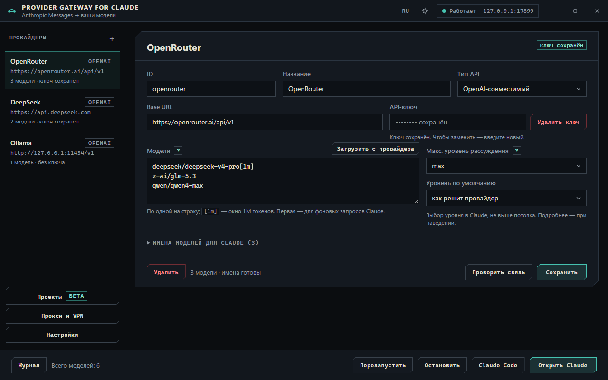
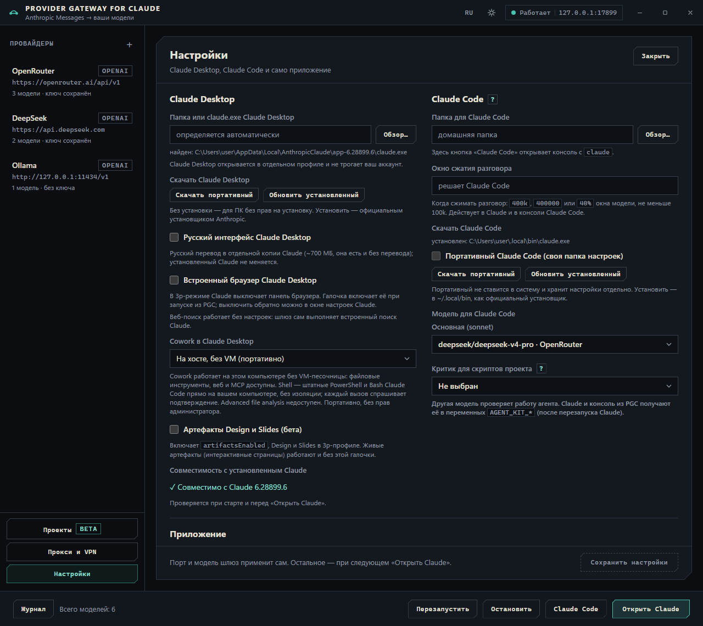
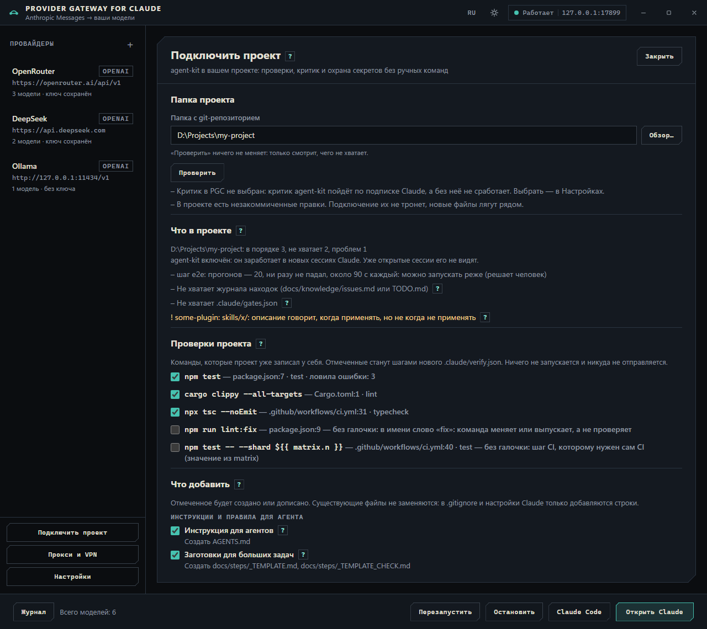

<p align="center">
  
</p>

<h1 align="center">Provider Gateway for Claude</h1>

<p align="center">
  Claude Desktop и Claude Code на тех моделях, которые выбрали вы:<br>
  OpenAI, OpenRouter, DeepSeek, Gemini, OpenCode, Ollama, LM Studio или любой OpenAI- либо Anthropic-совместимый API.
</p>

<p align="center">
  <a href="https://github.com/d-ridelman/provider-gateway-for-claude/releases/latest"></a>
  
  
  <a href="#лицензия"></a>
</p>

<p align="center">
  <a href="README.md">English</a> · <b>Русский</b>
</p>

<p align="center">
  
</p>

> **Неофициальный проект.** Не связан с Anthropic, не одобрен и не спонсируется ею. «Claude» — товарный знак Anthropic, PBC; здесь он только называет приложения, с которыми работает шлюз.

## Что это

Claude Desktop умеет работать в режиме стороннего провайдера, а Claude Code — с любым адресом в формате Anthropic API. Provider Gateway for Claude — небольшое приложение для Windows: оно поднимает такой адрес на `127.0.0.1` и переводит каждый запрос вашему провайдеру.

- **Anthropic Messages → OpenAI Chat Completions** со стримингом, вызовами инструментов, картинками (в том числе скриншотами, которые возвращают инструменты) и уровнями рассуждения; для Anthropic-совместимых провайдеров — прямая передача.
- **Claude Desktop в отдельном профиле**: ваш аккаунт Claude и чаты не трогаются. Модели появляются в меню выбора модели под понятными именами. Если этот Claude уже открыт, **«Открыть Claude»** лишь показывает его (и говорит, если настройки шлюза изменились); программа никогда его не закрывает и не перезапускает.
- **Claude Code в один клик**: консоль открывается в папке проекта, `claude` уже подключён к шлюзу и показывает настоящее имя вашей модели.

## Возможности

- Сколько угодно провайдеров, у каждого свои ключ, модели и потолок уровня рассуждения. Шаблоны для OpenAI, OpenRouter, OpenCode Go и Zen, DeepSeek, Gemini, Anthropic, Ollama, llama.cpp и LM Studio.
- **Загрузка списка моделей с провайдера** с подсказками из открытого [каталога моделей OpenCode](https://models.dev): имена, модели с окном 1M и поддерживаемые уровни рассуждения подставляются сами.
- **«Проверить связь»** отправляет через шлюз один настоящий запрос и показывает ответ.
- **Инструменты MCP по требованию.** Claude Code находит инструменты MCP своим поиском, как обычный Claude, а не отправляет схемы сотен инструментов в каждом ходе: с несколькими коннекторами ход занимает десятки тысяч токенов вместо 150–200 тысяч. Работает в консоли и во вкладке Code у Claude Desktop.
- **Бесплатный веб-поиск для Claude.** Встроенный `WebSearch` Claude (Claude Code и Claude Desktop) работает без ключей и настройки: шлюз отвечает на него сам, см. [Веб-поиск](#веб-поиск).
- **VPN-подписки и ядро mihomo.** Можно выбрать узел или «Авто», проверить задержку и решить, что идёт через VPN: только Claude и провайдеры, системный прокси (подходит доменным ПК) или весь трафик (TUN). См. [Прокси и VPN](#прокси-и-vpn).
- **Claude без установки.** Claude Desktop и Claude Code скачиваются с официальных адресов Anthropic: портативно, без установки в систему, или обычной установкой. Подпись и контрольная сумма сверяются, а подпись должна быть от собственного центра подписи кода Anthropic. См. [Claude без установки](#claude-без-установки).
- **Ключи лежат в диспетчере учётных данных Windows**, а не в файлах. Шлюз слушает только `127.0.0.1` и требует локальный токен на маршрутах сообщений и моделей; `/health` и заглушки настройки `/v1/oauth` отвечают без него. Файлы настроек пишутся через временный файл, поэтому оборванная запись не опустошит их.
- **Подстраивается под капризные модели.** Провайдеры принимают разное, и многие отвечают голым 400. Шлюз предотвращает известные беды (повтор имён инструментов; разговор, не влезший в окно, сообщается Claude Code так же, как это делает Anthropic, и он сам сжимает его), а когда модель отвергает запрос без объяснений, упрощает его по шагам: картинки убираются, уровень рассуждения, параметры сэмплирования и stream_options отбрасываются, имена инструментов сокращаются, подряд идущие сообщения сливаются, схемы инструментов упрощаются, инструментов остаётся не больше 128. Рассуждение прошлых ответов возвращается провайдерам, которым оно нужно (режим рассуждения DeepSeek с инструментами), и убирается у тех, кто его не принимает. Тот единственный шаг, который дважды подтвердил помощь для модели, запоминается в `model-profiles.json` рядом с настройками (удалить файл — забыть; записи живут 30 дней), а журнал шлюза пишет, что он сделал и что ответил провайдер.
- **Не ломается после обновлений Claude**: приложение читает правила моделей из установленной версии, сверяет поля конфигурации и показывает в настройках, если что-то перестало совпадать.
- **Русский интерфейс Claude Desktop** (по желанию): отдельная копия Claude с официальным русским переводом claude.ai. В этой копии в выборе папки Code есть и **«Без папки»**, который режим стороннего провайдера скрывает. Когда Claude обновляется, приложение готовит новую копию в фоне, и «Открыть Claude» не ждёт. Установленный Claude не меняется. Копия собирается и без русского языка (без перевода): только в ней процессы, которые запускает Claude (сессии Code, их npm, uv, git, MCP-серверы), видят настоящую папку `AppData\Local`, а не папку приложения. Если Claude пришёл пакетом MSIX без папки Squirrel, копия собирается из установленного пакета. Сама копия Claude не обновляет: новые версии ставит обычный Claude.
- **Cowork в Claude Desktop на 3P.** В режиме стороннего провайдера Claude ведёт Cowork на хосте, но собственная проверка выключает Cowork у любой копии, запущенной не из MSIX. Приложение патчит свою копию, чтобы Cowork работал там без пакета MSIX, прав администратора и VM, а Claude открывался на Chat, а не во вкладке Code. Свой shell Cowork живёт в VM, поэтому на хосте сессия получает PowerShell и Bash Claude Code без изоляции: каждый вызов спрашивает подтверждение. В настройках три режима: на хосте (портативно), выключен (только Chat) и через установленный пакет MSIX Claude с VM (в этом режиме русского перевода нет).
- **Артефакты (Design и Slides, бета)**: галочка в настройках включает их в 3p-профиле; живые артефакты работают и без неё.
- **Окно сжатия разговора**: поле в настройках принимает `400k`, `400000` или `40%` окна модели для моделей с `[1m]` — в Desktop и в консоли.
- **«Проекты»: подключить agent-kit и отключить** без команд в консоли: проверки после правок агента, вторая модель, которая проверяет его работу, и охрана секретов. Проверки проекта показаны с галочками, ничего не уходит с компьютера, а «Отключить…» убирает только то, что добавил agent-kit и вы не меняли. См. [Проекты](#проекты).
- **Модель-критик для скриптов проекта**: другая модель шлюза проверяет работу агента, так что проверка работает и без подписки Claude.
- **«?» у непростых настроек** открывает короткое пояснение простыми словами: что это, зачем и что будет, если ничего не трогать.
- **Работает в трее**: окно можно закрыть, шлюз продолжит работать.
- **Обновляется само** из релизов GitHub; каждое обновление сверяется с ключом подписи, встроенным в программу.
- **Переключатель встроенного браузера**: режим стороннего провайдера выключает у Claude Desktop панель браузера; галочка в Настройках включает её при каждом запуске из шлюза.
- Интерфейс на русском и английском, светлая и тёмная тема: по умолчанию как в Windows, а переключить можно кнопками в заголовке или в Настройках.

## Что нужно

- Windows 10 или 11, x64, с WebView2 (в Windows 11 он уже есть).
- [Claude Desktop](https://claude.ai/download) для чата. Проверено на Claude Desktop 6.28899.6.
- [Claude Code](https://docs.claude.com/en/docs/claude-code) для агента в терминале (по желанию). Проверено на Claude Code 2.1.331.
- Аккаунт и API-ключ хотя бы у одного провайдера или локальный сервер моделей.
- Только для **«Проектов»**: [Node.js](https://nodejs.org) 22 или новее, git и Claude Code.

## Установка

1. Скачайте `Provider-Gateway-for-Claude_<версия>_x64-setup.exe` со страницы [Releases](https://github.com/d-ridelman/provider-gateway-for-claude/releases).
2. Запустите. Установка только для текущего пользователя, права администратора не нужны.

Установщик пока не подписан сертификатом, поэтому SmartScreen может предупредить о неизвестном издателе: **Подробнее → Выполнить в любом случае**. Файл можно сверить с `SHA256SUMS.txt` из того же релиза:

```powershell
Get-FileHash .\Provider-Gateway-for-Claude_*_x64-setup.exe -Algorithm SHA256
```

К каждому релизу приложен и переносной `.exe`. Его встроенное обновление запускает установщик: после обновления у вас будет установленная версия, а сам переносной файл останется прежним.

## Быстрый старт

1. Нажмите **+**, выберите шаблон (например, *OpenRouter*) и вставьте API-ключ.
2. Нажмите **Загрузить с провайдера** и отметьте модели или впишите их ID по одному на строку. Модели с окном 1M токенов допишите `[1m]`.
3. Нажмите **Сохранить** — шлюз запустится сам.
4. **Открыть Claude** — Claude Desktop, **Claude Code** — консоль с CLI.

<p align="center">
  
  
</p>

### Уровни рассуждения

Задайте у провайдера **Макс. уровень рассуждения** — и Claude покажет выбор уровня для его моделей. Шлюз передаст выбранный уровень как `reasoning_effort` (OpenAI-совместимые) или `output_config.effort` (Anthropic), не выше потолка. **Уровень по умолчанию** используется, если Claude уровень не прислал, например Claude Code без `--effort`.

### Основная модель для Claude Code

Настройки → **Модель для Claude Code** выбирает модель шлюза для Claude Code. В консоли кнопки **Claude Code** на неё идут все роли, которые просит Claude Code: сессия, субагенты, которые наследуют модель (Explore, Plan), `model: opus`, `model: haiku` и `model: fable`, а каждый пункт `/model` показывает её по имени вместо Opus и Fable от Anthropic. Во вкладке Code у Claude Desktop (со следующего **«Открыть Claude»**) это основная модель (`sonnet`); остальные роли там Desktop выбирает сам. Ещё субагент может прямо указать любую модель шлюза в поле `model:`, а `/model <имя>` переключает сессию.

### Критик для скриптов проекта

Настройки → **«Критик для скриптов проекта»** выбирает вторую модель шлюза, которая проверяет работу агента (критик agent-kit отвечает ACCEPT или REJECT с причиной). Лучше модель, отличная от основной: у одной и той же модели одинаковые слепые пятна. Когда критик выбран и шлюз работает, Claude Desktop и консоль из PGC получают `AGENT_KIT_PGC_URL`, `AGENT_KIT_PGC_TOKEN` (локальный токен шлюза), `AGENT_KIT_PGC_MODEL` и `AGENT_KIT_CRITIC_VIA=pgc`, и скрипты проекта, запущенные там, могут к нему обратиться. Токен работает только на `127.0.0.1`, но его может прочитать любой скрипт из этих сессий. Смена критика шлюз не перезапускает.

### Проекты

<p align="center">
  
</p>

**«Проекты»** (слева внизу, с меткой beta: страница новая, её тексты и шаги ещё могут меняться) ставят в папку проекта [agent-kit](#agent-kit) — плагин Claude Code — без команд и так же убирают его:

1. **«Проверить»** ничего не меняет. Говорит, чего не хватает: Node.js 22+, git, Claude Code, git-репозитория, источника agent-kit, выбранного критика, есть ли незакоммиченные правки.
2. **«Подключить»** включает плагин только у вас (`.claude/settings.local.json`, вне git), если не отмечено **«Для всей команды»**. Выключенный вами плагин включается обратно только в этом проекте.
3. Дальше страница показывает, что есть в проекте, **проверки проекта** и **план с галочками**:
   - проверки — команды, которые проект уже записал у себя (скрипты package.json, Cargo, Makefile, pyproject, Go, его CI), у каждой файл и строка. Команды, имя которых говорит, что они что-то меняют или выкладывают (`fix`, `deploy`, `publish`…), стоят без галочки, с причиной. Отмеченные становятся шагами нового `.claude/verify.json`; свой `verify.json` проекта не меняется, шаги показываются, чтобы добавить их вручную. Ничего не запускается;
   - план собирает то, что agent-kit предлагает добавить (инструкции для агента, проверки и критик, защита, документы проекта), под понятными названиями; «?» говорит, зачем каждый пункт;
   - черновик правил критика из README, AGENTS.md и ADR самого проекта предлагается без галочки, у каждого правила — файл и строка, откуда оно взято.
4. **«Применить отмеченное»** применяет только отмеченное. Существующие файлы не заменяются; в `.gitignore` и настройки Claude дописываются строки. Новые сессии Claude видят плагин. **«Назад»** возвращает к папке.
5. У подключённой папки **«Отключить…»** показывает, что убрать, с галочками: файлы, которые добавил agent-kit и вы не меняли, и строки, которые он дописал в `.gitignore` и настройки Claude. Файл, который вы правили, показан, но не трогается. Плагин убирается из этого проекта в последнюю очередь (только у вас; «для всей команды» — отдельный пункт без галочки). Свои файлы agent-kit узнаёт по журналу рядом с git (`.git/agent-kit/applied.jsonl`); что было в git, возвращает git.

Модель не спрашивается, и файлы проекта никуда не отправляются: на 15 открытых проектах отбор кодом нашёл столько же проверок их CI, сколько модель.

#### agent-kit

В установщике и переносном exe есть закреплённая версия agent-kit (MIT). Если в Claude Code нет маркетплейса agent-kit, PGC распаковывает его в свою папку и ставит оттуда. Если agent-kit в PGC или в маркетплейсе-папке, которую вы добавили сами, отличается от копии в проекте, страница предлагает **«Обновить agent-kit»**; само ничего не обновляется.

### Веб-поиск

`WebSearch` Claude обычно выполняется на серверах Anthropic, поэтому через стороннего провайдера модель не получала ничего. Теперь шлюз отвечает на него сам, в том виде, как это делает сервер Anthropic: ищет в DuckDuckGo и Brave без ключей (ответы кэшируются на 10 минут; `allowed_domains` и `blocked_domains` инструмента учитываются). Когда поисковик просит проверку на человека, приложение открывает эту страницу в своём окне WebView2 как настоящий визит, а если нужна галочка, окно показывается само. Настраивать нечего, и переключателя пока нет: слова поиска уходят этим поисковикам (см. [Приватность и сеть](#приватность-и-сеть)). Проверено в консоли Claude Code и во вкладке Code Claude Desktop.

### Прокси и VPN

Кнопка **Прокси и VPN** слева внизу. Приложение запускает ядро [mihomo](https://github.com/MetaCubeX/mihomo) (Clash.Meta) с вашими VPN-подписками. Вставьте адрес подписки: подходят ссылки Clash/mihomo и base64-подписки с узлами vless, vmess, ss, trojan и hysteria2. Её узлы появятся плитками с задержкой. Узел выбирается кликом, **«Авто»** сам берёт самый быстрый. **«Проверить задержку»** замеряет все узлы, а трафик и срок подписки видны в её строке. Подписки ядро обновляет само раз в 6, 12 или 24 часа, а кнопка «Обновить» делает это сразу. В заголовке окна показан чип «VPN · узел · мс»; если ядро упало или прокси сбросила политика, он становится красным.

Что идёт через VPN:

| Режим | Что через VPN | Права |
|---|---|---|
| Только Claude и провайдеры | шлюз (запросы к провайдерам, веб-поиск, каталог моделей), Claude из PGC (`--proxy-server`) и консоль Claude Code (`HTTPS_PROXY`) | не нужны |
| Системный прокси | плюс браузеры и программы, что берут прокси Windows (и ваш обычный Claude) | не нужны — режим для доменных ПК |
| Весь трафик (TUN) | все программы | администратор: Windows спрашивает при каждом запуске ядра |

Локальные адреса, частные сети и имена `.local`, `.lan`, `.internal`, `.home.arpa` (Ollama, LM Studio, интранет) идут напрямую во всех режимах. Сервер в локальной сети, указанный именем без точки или корпоративным доменом, пойдёт через VPN; такой сервер лучше указывать по IP. Если ядро не работает, запросы шлюза падают с ошибкой и не уходят напрямую мимо VPN.

Ядро в программу не входит. Кнопка **«Скачать ядро»** берёт с GitHub автора закреплённую версию (сейчас v1.19.34, около 22 МБ) и сверяет её sha256, который зашит в PGC: новая версия ядра приходит вместе с обновлением PGC, подписанным его ключом. Ядро работает отдельным процессом и закрывается вместе с PGC. Некоторые антивирусы считают mihomo «потенциально нежелательной программой»: если файл уберут в карантин, окно скажет об этом и предложит скачать снова.

**Системный прокси** настраивается через WinINet, как это делает панель «Прокси» Windows. Прежние настройки (ручной прокси, PAC-сценарий, автообнаружение, список исключений) сохраняются до включения и возвращаются, когда вы выключаете режим или выходите из PGC. Если PGC упал, это произойдёт при следующем запуске; до тех пор программы смотрят в неработающий порт. Если смену прокси запрещает групповая политика, окно так и скажет, а режим «Только Claude и провайдеры» работает и тогда. Если доменный ПК выходит в интернет только через корпоративный прокси, ядро сейчас не умеет идти к узлам через него.

**TUN** запускает ядро с правами администратора через UAC; PGC при этом остаётся обычным процессом. Повышенный помощник закрывает ядро, когда закрывается PGC. Перед каждым запуском ядра сверяется sha256 самого `mihomo.exe`, и файл до старта закрыт от записи: подменить его в папке пользователя не выйдет. Если в доступе к UAC отказали, остаётся прежний режим. Если ядро упадёт, системный прокси вернётся сам, а чип станет красным.

Адрес подписки — это секрет: он хранится в диспетчере учётных данных, а окно и журнал показывают только сервер. Ядро получает его в своём файле конфигурации (`mihomo\home\config.yaml`) и хранит скачанный список узлов в `mihomo\home\providers`.

### Claude без установки

Настройки → **Скачать Claude Desktop** и **Скачать Claude Code**: оба можно взять с официальных адресов Anthropic двумя способами.

- **Без установки** (для ПК, где ставить программы нельзя). Claude Desktop распаковывается из полного пакета в папку приложения, а «Открыть Claude» запускает его. Claude Code кладётся туда же, и галочка «Портативный Claude Code» выбирает его для кнопки **Claude Code**. У портативного Claude Code своя папка настроек (`CLAUDE_CONFIG_DIR`) и выключено самообновление: обновляет его PGC той же кнопкой.
- **Установить** — официальный установщик Claude Desktop или `claude install` для Claude Code, как это делает сам Anthropic. Если Claude уже установлен, окно сначала спросит: это ваш обычный Claude.

Если в PGC включён VPN, скачивание идёт через него. Если при этом ядро не работает, загрузка не начинается, а окно говорит почему; если узел не отвечает, ошибка подскажет выбрать другой. Само ядро mihomo качается напрямую.

Проверка: у Claude Code sha256 из манифеста релиза, у Claude Desktop sha1 из `RELEASES` (так проверяет сам Squirrel). У каждого `claude.exe` проверяется подпись Authenticode «Anthropic, PBC». Портативный Claude при запуске прописывает в реестре `claude://`; после его закрытия PGC возвращает эти ключи установленному Claude, а если его нет — удаляет.

## Приватность и сеть

Приложение обращается к:

| Куда | Когда |
|---|---|
| К добавленным вами провайдерам | Когда Claude или Claude Code отправляет запрос, а также по «Загрузить с провайдера» и «Проверить связь» |
| `models.opencode.ai` | По «Загрузить с провайдера» — за именами и лимитами моделей; данных о вас не передаётся |
| `claude.ai/i18n/ru.json`, `claude.ai/i18n/dynamic/ru.json` | Только с включённым русским интерфейсом Claude, после обновления Claude |
| Источник agent-kit, который вы сами ввели в **«Проектах»** | Только если в Claude Code нет маркетплейса agent-kit и вы его задали; встроенному agent-kit сеть не нужна |
| `github.com` (релизы этого репозитория) | Проверка обновлений при старте и раз в сутки; выключается в настройках |
| `html.duckduckgo.com`, `lite.duckduckgo.com`, `search.brave.com` | Когда работает встроенный веб-поиск Claude: шлюз отвечает на него сам и отправляет слова, которые модель выбрала для поиска (без аккаунта и ключей). Включён всегда (переключателя пока нет) |
| `github.com/MetaCubeX/mihomo` (релизы) | Только по кнопке «Скачать ядро» |
| Адреса ваших VPN-подписок и их узлы | Пока включён прокси: ядро обновляет подписки и ходит через выбранный узел |
| `www.gstatic.com/generate_204` | Замер задержки узлов (ядро) |
| `1.1.1.1`, `dns.google` | DNS ядра, только в режиме TUN |
| `downloads.claude.ai`, `claude.ai` | Только по кнопкам «Скачать Claude Desktop / Claude Code» |

Телеметрии нет. Запросы и ответы идут только между Claude и вашим провайдером через локальный шлюз; слова веб-поиска уходят ещё и поисковым системам из таблицы. Эти слова записываются в `gateway.log` рядом с настройками открытым текстом.

## Где что лежит

| Что | Где |
|---|---|
| Настройки и журнал | `%APPDATA%\app.provider-gateway-for-claude` |
| Ключи провайдеров | Диспетчер учётных данных Windows, служба `claude-provider-gateway` |
| Профиль Claude Desktop для приложения | `%LOCALAPPDATA%\ClaudeProviderGateway\Claude-3p` |
| Копия Claude (~700 МБ, с переводом или без) | `%LOCALAPPDATA%\ClaudeProviderGateway\claude-ru` |
| Русский перевод claude.ai | `%APPDATA%\app.provider-gateway-for-claude\claude-ru.json` |
| Что шлюз узнал о капризных моделях | `%APPDATA%\app.provider-gateway-for-claude\model-profiles.json` |
| Ядро mihomo, его конфиг и журнал | `%LOCALAPPDATA%\ClaudeProviderGateway\mihomo` |
| Адреса VPN-подписок | Диспетчер учётных данных Windows, та же служба, имена `subscription:<id>` |
| Портативный Claude Desktop | `%LOCALAPPDATA%\ClaudeProviderGateway\claude-desktop\app-<версия>` |
| Портативный Claude Code и его настройки | `%LOCALAPPDATA%\ClaudeProviderGateway\claude-code` (`config` — его `CLAUDE_CONFIG_DIR`) |
| Встроенный agent-kit, распакованный | `%LOCALAPPDATA%\ClaudeProviderGateway\agent-kit` |
| Перевод меню уровней для установленного Claude | `%APPDATA%\app.provider-gateway-for-claude\claude-ru-dynamic.json` |
| Ваша модель Claude Code, сохранённая на время консоли PGC | `%LOCALAPPDATA%\ClaudeProviderGateway\code-model-before.json` |

claude.ai иногда отвечает программам проверкой на бота. Тогда приложение загружает перевод во встроенном браузере (WebView2), который проходит проверку, как обычный посетитель; если за несколько секунд она не прошла сама (claude.ai просит поставить галочку), окно появится, чтобы вы её завершили. Если не вышло и так, откройте `https://claude.ai/i18n/ru.json` в браузере и сохраните как этот `claude-ru.json` — точный путь покажет проверка совместимости в настройках.

## Сборка из исходников

Нужно: Rust 1.90+ с MSVC, Node.js (для проверки переводов в `tools\ci.ps1` и для установщика), Python 3 (по желанию, обновляет список лицензий).

```powershell
.\tools\ci.ps1               # переводы, fmt, clippy и тесты — как в GitHub CI
.\build-app.ps1              # переносной exe в dist\
.\build-app.ps1 -Installer   # и установщик NSIS
```

`git config core.hooksPath .githooks` запускает те же проверки перед каждым push.

В рабочем пространстве три крейта:

- `crates/ctp-core` — конфигурация и имена моделей, общие для остальных;
- `crates/ctp-gateway` — шлюз Anthropic Messages, работает и сам по себе (`ctp-gateway --providers-file providers.json`, токен клиентов — в `GATEWAY_TOKEN`);
- `crates/ctp-app` — приложение для Windows (Tauri 2).

agent-kit попадает в сборку, только если `.\tools\kit-snapshot.ps1` взял коммит из `crates\ctp-app\kit.pin` из клона agent-kit в `..\agent-kit`; без этого приложение работает, а «Подключить проект» ставит agent-kit из маркетплейса или заданного источника. Своего репозитория у agent-kit нет: он выходит только внутри PGC, и его исходники (MIT) — копия в установщике, которая распаковывается в `%LOCALAPPDATA%\ClaudeProviderGateway\agent-kit`. Без ключа обновлений проекта (`TAURI_SIGNING_PRIVATE_KEY`) `-Installer` соберёт обычный установщик без подписей обновлений. Релизы готовит `tools/release.ps1` (подписанный установщик, `latest.json`, контрольные суммы). `tools/cloudflare-mirror` — необязательное зеркало обновлений для сетей, где GitHub медленный или недоступен.

## Участие

Сообщения об ошибках, шаблоны провайдеров и переводы приветствуются: см. [CONTRIBUTING.md](CONTRIBUTING.md) и [список изменений](CHANGELOG.md). Об уязвимостях сообщайте приватно, как описано в [SECURITY.md](SECURITY.md).

## Лицензия

На выбор: [Apache License 2.0](LICENSE-APACHE) или [MIT](LICENSE-MIT). Сторонние компоненты и их лицензии перечислены в [THIRD-PARTY-NOTICES.txt](THIRD-PARTY-NOTICES.txt).
